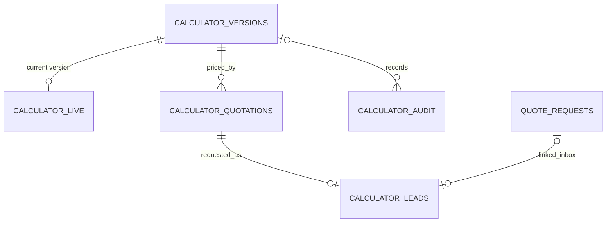

# Database schema

The singleton draft holds the editable JSON graph and optimistic revision. The version graph stores project types, sections, assignments, questions, options, rules, and settings together. Stable IDs and graph validation provide referential checks within the graph. Postgres foreign keys enforce the relationships between versions, quotations, leads and inbox records.

Quotation snapshots include the normalized answers, disclosure settings, billing totals, breakdown, project copy, version, creation date and validity. The reference and request UUID are unique. The stored access-token hash is separate from the snapshot. Removing an existing inbox row clears its link without removing the snapshot or calculator lead.

Audit records are append-only from the application. Calculator events contain consented session IDs and project or section IDs. Rate-limit counters contain keyed network or email digests. Read and write access to the new tables is restricted to the Edge Function service role. The normal customer or staff JWT cannot query the tables or internal RPCs.

Apply `202611260005_project_calculator.sql` followed by `202611260006_calculator_initial_catalog.sql`. They add tables, functions, and the draft seed. The existing Offers table receives a reserved-slug constraint for the new route.
